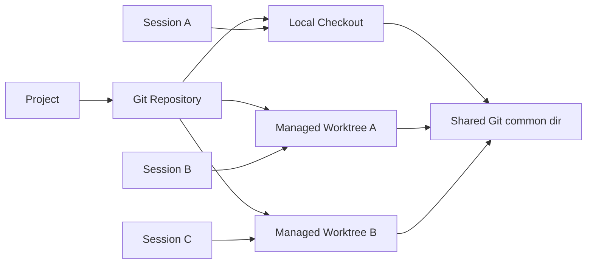

# 参考 Codex 的 Project Git 工作区与 Session 右侧栏技术方案

> 状态：设计稿，待评审后实施。
>
> 关联方案：[项目制（Project Workspace）技术方案](project-workspace-technical-solution.md)。本方案重新定义 Project、Session、Git 仓库、checkout 与 worktree 的关系，并替代此前“所有 Session 永远共享一个工作目录”或“每个 Session 自动创建分支”的设计。

## 1. Codex 调研结论

### 1.1 官方公开行为

Codex 的公开工作流把“仓库”和“任务运行目录”分开：

- 新任务先选择 host、repository/workspace 和运行环境；
- 任务可以直接使用当前 checkout，也可以创建新的 worktree；
- worktree 可以从指定分支或基线开始；
- worktree 用于隔离并行任务，让变更更容易审查；
- 完成后围绕 changed files、Diff、源码和 `/review` 做审查。

官方参考：

- [Mastering remote engineering work from your phone](https://developers.openai.com/blog/mastering-codex-remote-for-engineering)
- [Run long horizon tasks with Codex](https://developers.openai.com/blog/run-long-horizon-tasks-with-codex)

### 1.2 当前 Codex App 的本地契约

当前 Codex App 暴露的任务能力进一步说明了它的模型：

- 创建 Git 项目任务时可选择 `local` 或 `worktree`；Git 项目默认推荐 worktree，非 Git 项目使用 local；
- worktree 可从项目默认分支、指定分支或当前 working tree 开始；
- Fork 可留在 same-directory，也可创建 worktree；
- Handoff 可以把任务及其 Git 状态在项目 checkout 与 Codex worktree 之间移动；
- review 可以查看未提交修改、已暂存修改或相对某个基线分支的整体差异。

本机实际观察到的结构也符合这一模型：

```text
主 checkout: /Users/.../k_agent
Codex worktree: ~/.codex/worktrees/<slot>/k_agent

git rev-parse --git-common-dir
  -> 两者都指向主仓库的 .git

Codex worktree HEAD
  -> 默认可以是 detached HEAD
```

这说明 Codex 没有为每个任务强制创建业务分支。worktree 共享仓库的 object database 和 refs，但拥有独立的工作目录、index 和 HEAD。

官方资料和 App 契约没有公开 Worktree 状态迁移的内部算法。因此本文把“环境可选、Fork、Handoff、Review”视为已验证的产品语义；后文关于 patch 快照、锁、回滚和 fingerprint 的内容是 K Agent 为实现同类语义制定的方案，不声称是 Codex 的内部实现。

### 1.3 对 K Agent 的结论

“同一个 Project 下的 GitTree 是一样的”应拆成两个层次：

1. **Project 只有一个 Git 仓库身份。** 所有 Session checkout/worktree 共享同一个 Git common dir、对象库和 refs。
2. **Session 可以选择执行目录。** 它可以直接使用 Project 的主 checkout，也可以使用 K Agent 管理的独立 worktree。

Project 不是一棵永远共享的可变工作目录，Session 也不等于一个自动创建的 Git 分支。正确的绑定关系是：



## 2. 术语

### Project

用户保存的项目入口。它记录稳定路径、显示名和宿主机，Git 项目还记录仓库身份。Project 可以包含多个 Session。

### Repository

Git common dir 对应的仓库。对象、refs、remote 和 worktree 注册表属于 Repository。一个 Project 首版只绑定一个 Repository。

### Local Checkout

用户保存 Project 时选择的现有工作目录，即当前的 `Project.rootPath`。多个 local Session 可以指向它，因此文件和未提交修改是共享的。

### Managed Worktree

K Agent 通过 `git worktree add` 创建的隔离运行目录。它和 Local Checkout 共享 Repository，但有独立的文件、index 和 HEAD。

### Session

对话和运行历史。Session 持久绑定一个执行环境：Local Checkout 或 Managed Worktree。Session 本身不天然拥有分支。

### Review Baseline

Session 创建或 handoff 时记录的基线提交 OID。右侧栏用它计算本任务产生的完整变更，包括已提交和未提交内容。

## 3. 设计原则

1. **Project 管仓库，Session 管执行环境。** Project 不替所有 Session 强制选择同一个 cwd。
2. **Worktree 是隔离手段，branch 是用户选择。** 默认 worktree 使用 detached HEAD，不自动制造大量 `k-agent/*` 分支。
3. **Git 项目新 Session 默认使用 Managed Worktree。** 用户明确选择“直接在项目目录工作”时使用 Local Checkout。
4. **非 Git 项目使用 Local Checkout。** 不为了创建会话而偷偷 `git init`。
5. **变更审查以 Session 的 baseline 和 cwd 为边界。** 右侧栏回答“这个任务相对开始时改了什么”。
6. **环境可以 handoff。** 用户可以把隔离工作移回主 checkout，也可以把 local 工作转入 worktree。
7. **运行配置不进入代码 Diff。** MCP、Skill、reasoning、审批桥等配置保存在 Session runtime 目录。
8. **Git 操作保持轻量。** 产品提供环境选择、变更审查、Fork 和 Handoff；完整 Git GUI 不是首版目标。

## 4. 用户流程

### 4.1 新建 Project

Project 创建只登记目录并探测环境：

```text
目录不存在 -> 创建空目录
目录存在   -> 直接登记，不改文件

探测：
  Git repository?  yes/no
  repository root
  git common dir
  current checkout
  default branch / HEAD
  setup command
```

这里不自动生成首次提交、不自动创建分支，也不应覆盖项目里的 README、Git 配置或指令文件。项目模板是独立功能，不能和 Project 登记混在一起。

### 4.2 在 Project 下新建 Session

Git Project 默认直接创建 Managed Worktree；新建按钮旁的二级菜单允许选择：

```text
新建任务
  ├── 在 Worktree 中开始（默认）
  └── 在项目目录中开始
```

选择 Worktree 后还可展开高级项：

- 从默认分支开始；
- 从指定本地分支/ref 开始；
- 包含当前 checkout 的未提交修改；
- 创建用户指定的新分支。

普通点击不弹复杂对话框，按默认分支创建 detached worktree。只有用户展开高级项时才要求选择基线或分支。

非 Git Project 直接创建 Local Session，不展示无效的 Worktree 选项。

### 4.3 Fork Session

Fork 的首要语义是复制已完成的对话历史。执行环境由用户选择：

- **同目录 Fork**：新 Session 继续使用源 Session 的 cwd；两者看到同一份文件状态；
- **Worktree Fork**：从源 Session 当前 HEAD 创建新的 detached worktree；
- 源目录有未提交修改时，可选择是否把 working tree 状态复制到新 worktree。

同目录 Fork 不复制文件；Worktree Fork 才创建隔离副本。运行中的 active turn 不进入 Fork，保持与 Codex 的“只复制已完成历史”一致。

### 4.4 Handoff

Handoff 改变 Session 的执行环境，不新建对话：

```text
Local Checkout  <---- handoff ---->  Managed Worktree
```

典型用途：

- 用户先在 worktree 中让 Agent 完成修改，审查后移回项目 checkout；
- 用户在 checkout 中开始调查，发现任务较大，再转为隔离 worktree；
- 需要在另一台保存了同一 Project 的 host 上继续任务。

Handoff 必须把 Session、cwd 绑定、baseline 和关联 Git 状态作为一个操作迁移。执行中的 Session 先中断到安全边界，再开始迁移。

## 5. 数据模型

### 5.1 Project

```python
class ProjectRecord(BaseModel):
    id: str
    name: str
    root_path: str = Field(alias="rootPath")
    host_id: str | None = Field(default=None, alias="hostId")
    is_git_repository: bool = Field(alias="isGitRepository")
    repository_root: str | None = Field(default=None, alias="repositoryRoot")
    git_common_dir: str | None = Field(default=None, alias="gitCommonDir")
    setup_command: str | None = Field(default=None, alias="setupCommand")
    created_at: datetime = Field(alias="createdAt")
    updated_at: datetime = Field(alias="updatedAt")
```

`isGitRepository`、`repositoryRoot` 和 `gitCommonDir` 是最近一次探测结果。打开 Project 或创建 Session 时需要重新验证，不能只相信旧缓存。

### 5.2 Session 环境绑定

```python
class SessionEnvironmentBinding(BaseModel):
    kind: Literal["local", "worktree"]
    project_id: str = Field(alias="projectId")
    host_id: str | None = Field(default=None, alias="hostId")
    cwd: str
    repository_root: str | None = Field(default=None, alias="repositoryRoot")
    git_common_dir: str | None = Field(default=None, alias="gitCommonDir")
    worktree_id: str | None = Field(default=None, alias="worktreeId")
    base_oid: str | None = Field(default=None, alias="baseOid")
    branch_ref: str | None = Field(default=None, alias="branchRef")
    detached: bool = False
    starting_state: Literal["default", "branch", "working_tree"] = Field(alias="startingState")
    setup_status: Literal["pending", "running", "ready", "failed"] = Field(alias="setupStatus")
    setup_error: str | None = Field(default=None, alias="setupError")
```

Session 创建完成前可以处于 `pending/running`。Worktree 和依赖准备可能耗时，创建 API 不应让前端假装已经可运行。

### 5.3 不持久化的状态

以下信息每次从 Git 读取：

- 当前 HEAD、分支和 detached 状态；
- staged、unstaged、untracked 和 conflicts；
- ahead / behind；
- worktree 注册是否仍有效；
- remote 状态。

数据库保存绑定与 baseline，Git 保存代码事实。

## 6. Worktree 创建

### 6.1 默认创建

默认从 Project 默认分支的当前 OID 创建 detached worktree：

```text
git worktree add --detach <managed-path> <base-oid>
```

目录建议：

```text
$K_AGENT_HOME/worktrees/{projectId}/{sessionId}/{projectName}/
```

它不放入 Project 目录，避免文件树递归和误提交。`worktreeId` 使用内部稳定 ID，不依赖目录 basename。

创建流程：

1. 重新探测 Project 和 Git；
2. 把起始 ref 解析成不可变 OID；
3. 创建 Session provisional record，状态为 `pending`；
4. 在 Repository 短锁内执行 `git worktree add --detach`；
5. 校验新目录的 `git-common-dir` 与 Project 一致；
6. 根据 starting state 复制 working tree 状态；
7. 执行项目 setup command；
8. 写入最终 binding，状态改为 `ready`。

失败时保留可读错误，清理确认安全的半成品目录；无法确认的 Worktree 标记为 orphan，交给 repair 流程。

### 6.2 从 working tree 开始

“包含当前 checkout 的未提交修改”不能通过单纯指定 commit 完成。创建时需要冻结一个一致快照：

1. 记录 checkout HEAD、index tree 和 status fingerprint；
2. 创建 detached worktree；
3. 复制 staged patch、unstaged patch 和未跟踪文件；
4. 再次核验源 checkout fingerprint；
5. 若源状态变化，删除未发布 worktree 并返回 `STARTING_STATE_CHANGED`。

首版可以把 staged/unstaged 都还原成 worktree 中的未暂存修改，但 UI 必须明确说明；如果需要保持暂存边界，则分别应用两份 patch。

### 6.3 显式分支

只有用户明确选择“创建新分支”时才执行：

```text
git worktree add -b <branch> <path> <base-oid>
```

选择已有分支前必须检查该分支是否已经被其他 worktree checkout。默认 detached 避免分支占用冲突，也减少临时分支噪音。

## 7. Workspace Resolver

新增唯一入口 `SessionWorkspaceResolver`：

```python
class SessionWorkspaceResolver:
    async def resolve(session_id: str) -> ResolvedWorkspace:
        # 返回 cwd、projectId、environmentKind、repositoryRoot、gitCommonDir、baseOid
        ...
```

以下功能必须全部使用它：

- Agent Runner cwd；
- Bash 和文件工具 sandbox root；
- 终端 cwd；
- 文件树和文件预览；
- CLAUDE.md / AGENTS.md / MCP 项目配置发现；
- Diff 和 review；
- setup command；
- Session resume 和审批恢复。

禁止 gateway、终端路由和文件预览各自实现一套“有 projectId 就用 rootPath”的分支逻辑。否则 worktree Session 会出现 Agent 在隔离目录、终端却打开主 checkout 的错误。

## 8. 并发模型

锁按实际 workspace 而不是只按 Project：

| 场景 | Session 锁 | Workspace 锁 | Repository 短锁 |
|---|---:|---:|---:|
| Local Session Agent Run | 是 | `cwd` 级整轮锁 | 否 |
| Worktree Session Agent Run | 是 | `cwd` 级整轮锁 | 否 |
| 同目录 Fork 的两个 Session | 是 | 共享同一把 `cwd` 锁 | 否 |
| 不同 Worktree 并行运行 | 各自 | 各自 | 否 |
| 创建/删除 Worktree | 是 | 否 | 是 |
| 创建/删除/更新 refs | 是 | 必要时 | 是 |
| 只读 status/diff | 否 | 否 | 否 |

这带来 Codex 式的核心收益：同一 Project 下的隔离 Worktree 可以并行，直接使用 Local Checkout 的任务仍按目录串行。

Repository 短锁只保护 `git worktree` 元数据和 refs 操作，不能覆盖整个 Agent Run。当前单进程 `asyncio.Lock` 仅适合单 worker，多 worker 需要文件锁或分布式锁。

## 9. Review 模型

K Agent 首版不做完整 Git GUI。右侧栏围绕“任务产出了什么”设计，而不是复制 IDE Source Control。

### 9.1 变更集合

Worktree Session 的 review 基线是 `binding.baseOid`：

```text
committed changes: baseOid..HEAD
index changes:     HEAD -> index
working changes:   index -> working tree
untracked files:   cwd 中未跟踪内容
```

右侧栏默认合并展示“相对 baseOid 的最终变更”，同时允许展开查看 committed / staged / unstaged 层次。即使 Agent 在 detached HEAD 上创建了提交，变更仍然不会从 review 中消失。

Local Session 同样记录 `baseOid`，但如果多个 Session 共享同一个 checkout，页面必须标注“此目录由多个任务共享，变更不保证仅来自当前 Session”。

### 9.2 Diff 安全边界

- 使用 `git diff --no-ext-diff --no-textconv`；
- 文件路径使用 NUL 分隔的 porcelain 输出；
- 限制单文件和总 Diff 字节数；
- 二进制文件只展示元信息；
- 不解析本地化的人类输出；
- remote URL 在返回前去除凭据；
- Diff fingerprint 由 baseOid、HEAD、index 和 status 摘要计算。

### 9.3 Review 反馈

右侧 Diff 支持选择行并添加评论。评论转成下一条用户消息的结构化上下文：文件、左右侧、行号和评论正文。评论不直接写进源码，也不在用户提交前发送。

## 10. Handoff

### 10.1 Worktree 到 Local Checkout

Handoff 前置条件：

- 源 Session 不在运行；
- 目标 checkout 没有其他运行中的 local Session；
- Project Repository 与 binding 的 git common dir 一致；
- 源 review fingerprint 在确认后没有变化。

迁移流程：

1. 计算源相对 `baseOid` 的完整变更；
2. 检查目标 checkout HEAD 和工作区状态；
3. 生成迁移计划：可直接应用、需要三方合并或存在冲突；
4. 先在临时 index/目录中验证应用结果；
5. 成功后写入目标 checkout；
6. 比较源与目标最终 tree/file fingerprint；
7. 更新 Session binding 为 `local`；
8. 原 Worktree 标为可回收，异步清理。

目标 checkout 有无关未提交修改时默认拒绝，不自动 stash、reset 或覆盖。冲突时保留源 Worktree，不留下半完成 handoff。

### 10.2 Local Checkout 到 Worktree

Local Session 转入 Worktree 时，以当前 checkout HEAD 为 base，并复制当前 working tree 状态。因为共享 checkout 的变更无法可靠归属某个 Session，存在多个绑定到同一 cwd 的活跃 Session 时阻止 handoff，要求用户先收敛到一个任务。

复制验证成功后更新 Session binding。首版保留 Local Checkout 原文件不自动清理，UI 明确提示两边暂时包含相同变更；后续可增加经过确认的“从原目录移除已迁移修改”。

### 10.3 跨 Host

跨 Host handoff 只有在目标 Host 保存了同一 Repository identity 时开放。Repository identity 不能只用绝对路径，应优先使用规范化 remote + 初始提交/仓库指纹；没有 remote 的仓库需要用户显式选择目标 Project。

跨 Host 不复制 `.git` 目录。通过提交、patch bundle 和未跟踪文件包传递任务状态，传输完成后再次校验 fingerprint。

## 11. Fork

### 同目录 Fork

- 新 Session 复用源 binding.cwd；
- 两个 Session 共享所有文件变化；
- Workspace 锁保证同一时刻只有一个 Agent Run 写该目录；
- 右侧栏显示“共享工作区”。

### Worktree Fork

- 从源 HEAD 创建新的 detached worktree；
- 默认不带未提交修改；
- 用户选择“包含当前修改”时复制源 working tree 状态；
- 新 Session 记录自己的 baseline 和 worktreeId；
- 两个 Session 之后可以并行。

## 12. Session 右侧栏

### 12.1 信息架构

项目 Session 显示：

```text
轨迹 | 变更 | 文件
```

- **轨迹**：当前 Session 的运行事件；
- **变更**：相对 Session baseline 的 Review；
- **文件**：当前 Session cwd 的文件树。

右侧栏顶部展示执行环境：

```text
project_test
Worktree · detached @ ee6b046
基于 master-mac
```

或：

```text
project_test
Local checkout · master-mac
与其他 2 个任务共享目录
```

### 12.2 变更页

```text
┌──────────────────────────────────────┐
│ CHANGES                              │
│ 4 files · +83 -21                    │
├──────────────────────────────────────┤
│ M  frontend/src/App.tsx      +42 -8  │
│ M  access_layer/gateway.py   +18 -6  │
│ A  docs/design.md            +23     │
│ D  old-notes.md                  -7  │
├──────────────────────────────────────┤
│ [Review] [移到项目目录] [···]        │
└──────────────────────────────────────┘
```

点击文件进入 Diff；Review 模式支持逐行评论。`···` 提供：

- 与分支比较；
- 创建分支；
- 复制 Worktree 路径；
- 在终端打开；
- 修复或重新创建 Worktree；
- 回收 Worktree。

首版不在这里提供 Stage、Commit、Pull、Push 按钮。Agent 或用户可以在终端执行 Git；产品层先把环境隔离、Diff 审查和 Handoff 做正确。

### 12.3 新 Session 和环境切换入口

Project 行右侧的新建会话按钮保持一键默认行为：Git Project 创建 Worktree，非 Git Project 使用 Local。长按/二级菜单才选择环境和 starting state。

环境标签可以点击打开详情，但切换必须走 Handoff，不能直接改一个 `cwd` 字段。

### 12.4 刷新

触发变更刷新：

- 打开 Session；
- 工具调用完成；
- Run 完成；
- 窗口重新获得焦点；
- Handoff/Fork/创建分支完成；
- 空闲 8 秒、运行中 2.5 秒兜底轮询。

缓存键必须包含 `sessionId + cwd + baseOid + fingerprint`。同 Project 的不同 Worktree 不能复用同一份 changed files 缓存；同目录 Fork 可以共享 workspace status 缓存，但 review baseline 仍按 Session 区分。

## 13. API

### Project

```text
GET  /api/projects/{projectId}/repository
POST /api/projects/{projectId}/sessions
```

创建 Session 请求：

```json
{
  "environment": "worktree",
  "startingState": {
    "type": "default"
  }
}
```

其他 starting state：

```json
{"type": "working-tree"}
{"type": "branch", "branchName": "feature/login", "onMissing": "error"}
{"type": "branch", "branchName": "feature/login", "onMissing": "create-branch"}
```

只有用户明确要求创建该精确分支名时才允许 `create-branch`。

### Session 环境

```text
GET  /api/sessions/{sessionId}/environment
POST /api/sessions/{sessionId}/handoff
POST /api/sessions/{sessionId}/fork
POST /api/sessions/{sessionId}/environment/repair
POST /api/sessions/{sessionId}/environment/reclaim
```

### Review

```text
GET /api/sessions/{sessionId}/changes
GET /api/sessions/{sessionId}/diff?path=<relative>&view=<working|staged|base>
GET /api/sessions/{sessionId}/compare?baseRef=<ref>
```

环境创建和 handoff 返回 operationId，前端通过状态事件或带 revision 的长轮询获取 `pending/running/ready/failed`，避免高频无变化轮询。

## 14. 生命周期与清理

### Session 归档

归档只改变侧栏可见性，不立即删除 Worktree。恢复 Session 后仍能使用原 cwd。

### Session 删除

删除对话前检查 Managed Worktree：

- 无变更且无独有提交：可直接回收；
- 有变更或 base 之后有提交：保留 Worktree，并把删除操作降级为“删除对话、保留工作区”；
- 彻底丢弃需要单独展示变更摘要并明确执行。

### Orphan Reconcile

启动和 Project 打开时用 `git worktree list --porcelain -z` 对账：

- binding 存在、Worktree 缺失：`missing`；
- Worktree 存在、Session 不存在：`orphaned`；
- git common dir 不一致：`foreign`；
- Git 标记 prunable：先展示，再由 repair/reclaim 处理。

不自动运行会丢信息的 `git worktree prune`。

## 15. 项目规则、Skill 与 MCP

- Local 和 Worktree 都从各自 cwd 发现 `AGENTS.md`、`CLAUDE.md` 和项目规则；
- 被 Git 跟踪的项目规则随起始 commit 出现在 Worktree；
- checkout 中未提交的新规则只有在 `startingState=working-tree` 时复制；
- Skills 继续由 `$K_AGENT_HOME/content/skills` 管理并按 Session 选择；
- MCP、Codex reasoning 和审批桥配置写到 Session runtime 目录，通过 Runner 参数或隔离 runtime home 注入；
- 禁止覆盖仓库中已跟踪的 `.mcp.json` 或 `.codex/config.toml`；
- K Agent 自己生成的运行配置不能出现在 changed files 和 Diff 中。

## 16. 错误模型

| 错误码 | 含义 | UI 行为 |
|---|---|---|
| `PROJECT_NOT_GIT_REPOSITORY` | Project 不是 Git 仓库 | 使用 Local 环境 |
| `WORKTREE_SETUP_PENDING` | 环境仍在准备 | 显示进度，禁止运行 |
| `WORKTREE_CREATE_FAILED` | Git worktree 创建失败 | 展示诊断和重试 |
| `WORKTREE_UNAVAILABLE` | 已绑定 Worktree 丢失 | 提供 Repair/Handoff |
| `WORKTREE_FOREIGN_REPOSITORY` | common dir 与 Project 不同 | 禁止运行 |
| `STARTING_STATE_CHANGED` | 复制 working tree 时源状态变化 | 刷新并重试 |
| `WORKSPACE_BUSY` | 同 cwd 有其他 Run | 显示占用 Session |
| `REPOSITORY_BUSY` | Git 元数据操作冲突 | 稍后重试 |
| `HANDOFF_TARGET_DIRTY` | 目标 checkout 有冲突变更 | 保留源 Worktree |
| `HANDOFF_CONFLICT` | 迁移预检存在冲突 | 展示冲突文件，不写目标 |
| `REVIEW_STATE_CHANGED` | 用户审查后 Diff 已变化 | 刷新 Review |
| `BRANCH_ALREADY_CHECKED_OUT` | 分支被其他 Worktree 占用 | 定位占用任务 |

## 17. 现有代码改造

### Access Layer

- `access_layer/projects/repository.py`：仓库探测、identity 和 common-dir；
- `access_layer/projects/worktree_manager.py`：创建、对账、修复和回收；
- `access_layer/projects/handoff.py`：迁移计划、验证和提交；
- `access_layer/projects/models.py`：Project repository 字段；
- `access_layer/sessions/store.py`：持久化 environment binding；
- `access_layer/sessions/workspace.py`：改为统一 resolver；
- `access_layer/concurrency.py`：从 Project 长锁改为 workspace 长锁 + repository 短锁；
- `access_layer/gateway.py`：只从 resolver 获取 cwd；
- `access_layer/main.py`：Environment、Fork、Handoff 和 Review API；
- `access_layer/projects/scaffold.py`：移除 Project 登记时自动 Git scaffold 的职责；
- `backend/runners/claude_mcp.py`、`backend/runners/codex_config.py`：运行配置外置。

### Frontend

- `frontend/src/types.ts`：EnvironmentBinding、SetupOperation、ChangeSummary 和 Diff 类型；
- `frontend/src/api/agui.ts`：创建环境、Fork、Handoff 和 Review API；
- `frontend/src/App.tsx`：项目新 Session 默认环境和右栏 `trace | changes | files`；
- `frontend/src/components/SessionEnvironmentBadge.tsx`：Local/Worktree 状态；
- `frontend/src/components/SessionChangesPanel.tsx`：changed files、Diff 和 review comments；
- `frontend/src/components/ProjectCreateDialog.tsx`：只选择/创建目录，不隐式初始化仓库；
- `frontend/src/components/ContentStage.tsx`：文件树绑定 resolved cwd。

## 18. 迁移

现有 Project Session 都直接使用 `rootPath`，迁移时记录为：

```json
{
  "kind": "local",
  "cwd": "<project.rootPath>",
  "startingState": "default",
  "setupStatus": "ready"
}
```

不自动把旧 Session 移入 Worktree，因为共享 checkout 中无法判断现有变更属于哪个 Session。用户可以对某个空闲 Session 手动执行 Handoff。

新版本启用后：

- 新建 Git Project Session 默认 Worktree；
- 新建非 Git Project Session 默认 Local；
- 已有 Session 行为不变；
- 原 Project 级长锁继续保护所有 legacy local Session；
- 完成 workspace lock 改造后，不同 Managed Worktree 才允许并行。

## 19. 实施阶段

### 阶段一：环境模型和只读 Review

- Repository 探测；
- Session environment binding 和 resolver；
- 现有 Session 迁移为 Local；
- 右侧栏 changed files、Diff 和环境标识；
- Runner 配置外置。

### 阶段二：Managed Worktree

- 默认 detached worktree 创建；
- setup operation 状态；
- workspace 锁和并行运行；
- repair、reconcile 和安全回收。

### 阶段三：Fork 与 Handoff

- same-directory/worktree Fork；
- Local 与 Worktree 双向 handoff；
- startingState=working-tree；
- review comments 和完整迁移预检。

### 阶段四：跨 Host

- Repository identity；
- patch bundle 传输；
- 目标 Project 匹配；
- 可恢复 operation 状态。

## 20. 测试与验收

### 后端测试

- Git/non-Git、subdirectory Project、detached HEAD、unborn 和 bare repo 探测；
- `git-common-dir` 一致性；
- 默认 worktree 不创建分支；
- 指定 branch 与 create-branch 授权边界；
- working-tree 起始状态的 staged/unstaged/untracked 复制和并发变化；
- Agent、终端、文件预览、规则发现和 Review 使用同一 cwd；
- 同 cwd Session 串行、不同 Worktree 并行；
- Fork 两种环境模式；
- Handoff 成功、目标脏、状态变化和冲突回滚；
- 删除带变更 Worktree 不丢数据；
- orphan/missing/foreign reconcile；
- 路径逃逸、symlink、命令参数注入和 Diff 截断；
- runtime 配置不进入 Diff。

### 前端测试

- Git Project 一键新建默认为 Worktree；
- 非 Git Project 不显示 Worktree 默认项；
- setup pending/failed/ready 状态；
- Local/Worktree/共享目录标签准确；
- changed files 相对各自 Session baseline；
- 同 Project 不同 Worktree 不串用 Diff 缓存；
- 同目录 Fork 显示共享提示；
- Handoff 预检、进度、失败和恢复；
- 行评论只在用户提交 review 后进入对话。

### 验收场景

1. 同一 Project 新建两个默认 Session，得到两个共享同一 Repository 的 detached Worktree；
2. 两个 Worktree 可以并行修改同名文件而互不覆盖；
3. 两个 Session 的右侧栏分别显示相对各自 baseline 的变更；
4. 用户选择“在项目目录中开始”后，Session 直接使用 `rootPath`；
5. 同目录 Fork 共享文件，Worktree Fork 隔离文件；
6. Worktree 任务完成后可以预检并 Handoff 到干净的 Local Checkout；
7. Project 中已有未提交修改时，`startingState=working-tree` 能创建内容一致的 Worktree；
8. Session 归档和应用重启后仍能恢复原环境；
9. 删除带变更的 Session 不会静默删除 Worktree；
10. MCP/Codex 运行配置不污染 Review。

## 21. 关键决策

- 同一 Project 共享一个 Git Repository/common dir；
- Session 显式绑定 Local Checkout 或 Managed Worktree；
- Git Project 新 Session 默认 Worktree，非 Git Project 默认 Local；
- 默认 Worktree 使用 detached HEAD，不自动创建 Session 分支；
- Session 可以 same-directory Fork、Worktree Fork 和双向 Handoff；
- Review 相对 Session baseline，不把整个 Project 状态误称为本任务变更；
- 锁按 cwd 隔离，Repository 元数据操作使用短锁；
- 右侧栏聚焦 changed files、Diff、review 和 handoff，不在首版复制完整 Git GUI；
- 旧 Project Session 保持 Local，不自动迁移；
- Project 登记与 Git 初始化/模板生成解耦。
