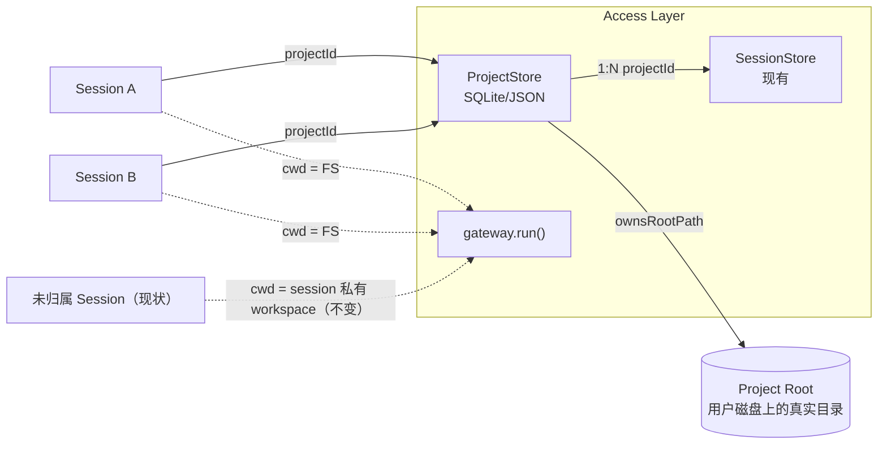

# 项目制（Project Workspace）技术方案

> 后续设计：参考 Codex 的 checkout/worktree 环境选择、变更审查、Fork、Handoff 和 Session 右侧栏交互见 [Project Git 工作区与 Session 右侧栏技术方案](project-git-tree-technical-solution.md)。

> 定位：在现有扁平的 Session 列表之上，新增一个极薄的「项目（Project）」实体——它本质上就是一个被多个会话共用的文件夹，外加一张记录“哪些会话绑定了这个文件夹”的索引表。会话之间的“信息共享”完全靠共用同一个磁盘目录自然发生（谁写的文件，其他会话立刻能看到），不需要额外设计一套共享机制。

## 1. 现状调研结论

### 1.1 代码里已经有的「项目」概念，但只是“按目录扫描”，不是实体

仓库里确实多处出现 `PROJECT`，但都只是**某个目录是否存在某种配置文件**的静态扫描结果，没有对应的持久化领域对象：

- `backend/memory/models.py` 的 `MemoryType.PROJECT`：`discovery.py` 从 `instruction_root` 开始向上找 `CLAUDE.md` / `.claude/rules/*.md`，找到就标记成 `PROJECT` 级 memory。

```14:14:/Users/kanema/Desktop/k_agent/backend/memory/models.py
    PROJECT = "project"
```

- `access_layer/mcp_config.py` / `backend/mcp_tool/config.py` 的 `McpScope.PROJECT`：如果 cwd 下有 `.mcp.json` 就按 `PROJECT` 优先级加载。

```117:117:/Users/kanema/Desktop/k_agent/backend/mcp_tool/config.py
    sources.append((cwd / ".mcp.json", McpScope.PROJECT))
```

- `docs/features/agent-team-technical-solution.md` 里明确写了这是未来要做、现在没做的事：

```162:162:/Users/kanema/Desktop/k_agent/docs/features/agent-team-technical-solution.md
当前非编码任务模式不会创建或复制 Git 仓库；未来编码模式需要显式选择目标项目后再按需启用 worktree。
```

也就是说：**“项目级指令/项目级 MCP”这套发现逻辑已经写好了，但从来没有一个叫“项目”的持久化实体去驱动它**——它依赖的 `instruction_root` / `cwd`，目前永远等于一次性的会话 workspace，而不是用户长期维护的某个代码库或资料目录。

### 1.2 当前真实的数据模型：Session 是唯一的一等公民，且天然隔离

`access_layer/home.py` 定义的持久化布局里，没有 project 这一层：

```16:21:/Users/kanema/Desktop/k_agent/access_layer/home.py
  state/
    sessions/{id}/           # 会话 JSON + workspace/
    teams/                   # Team 控制面与任务目录
  content/
    memory/ / skills/
```

每个会话在创建时各自拿到一个独立、随会话生命周期走的 workspace：

```190:194:/Users/kanema/Desktop/k_agent/access_layer/home.py
def session_workspace_dir(session_id: str) -> Path:
    """对话绑定的 CLI/本地工具 cwd（非 Team 任务目录）。"""

    return session_bundle_dir(session_id) / "workspace"
```

运行时直接把这个目录当成 `instruction_root` / `cwd` 喂给 Runner（`access_layer/gateway.py`），sandbox 的可写根也来自同一个目录（`backend/sandbox/plan.py: allow_write = [str(workspace_root), ...]`）。

结果是：

- 两个“同一个项目”的对话，workspace 是两个毫不相干的空目录，彼此看不到对方写过的文件。
- `.mcp.json` / `CLAUDE.md` 这种“项目级”配置，用户必须在**每个会话的 workspace 里重复放一份**才会被发现——但会话 workspace 本来就是一次性、用完即弃的，没人会这么做，所以 `MemoryType.PROJECT` / `McpScope.PROJECT` 在实际产品里几乎从未被触发。
- `Team` 也是一样：`workspaceDir` 是 Team 级的，但 Team 和 Session 之间、Team 和 Team 之间都没有更上层的“项目”把它们串起来；`agent-team-technical-solution.md` 自己也承认“未来编码模式需要显式选择目标项目”还没做。
- 前端（`frontend/src/App.tsx`）的会话列表是纯扁平列表（`sessions: SessionSummary[]`），没有任何分组字段。

### 1.3 结论

“项目制”目前只存在于：① 代码里零散的 `PROJECT` 级配置发现逻辑，② 架构文档里一句面向未来的承诺。**没有 Project 持久化实体、没有 Project API、没有 Project 工作目录、没有会话到项目的归属关系、前端没有项目维度的 UI。** 本方案要补的就是这一层。

## 2. 术语澄清：Project 和 Session / Team 的关系

- **Session（对话）**：一次连续的人机对话流（现有概念，不变）。
- **Team（任务制）**：一次有明确目标、由多个 Agent 协作完成、可暂停可恢复的*任务*（见 `agent-team-technical-solution.md`，当前仍是设计稿）。
- **Project（项目制，本方案新增）**：一个**稳定的文件夹 + 一份归属关系**，仅此而已：
  - 一个稳定的根目录（可以是全新建的空目录，也可以是用户磁盘上已有的代码仓库）；
  - 多个归属于它的 Session（未来也可以是 Team），这些 Session 运行时直接把这个目录当 cwd，而不是各自的一次性私有 workspace；
  - 因为所有会话共用同一个目录，`CLAUDE.md`（项目记忆）、`.mcp.json`（项目 MCP）这些现有的“按目录扫描”能力会自然对该目录下所有会话生效——这不是 Project 新增的功能，只是共用目录的副作用。

三者是正交的：Project 解决“工作目录与配置复用”，Session 解决“一段对话”，Team 解决“多 Agent 协作执行一次任务”。Team 的 `workspaceDir` 以后可以选择性地绑定到某个 Project 根目录（对应 1.1 节提到的那句 TODO），但 Team 领域模型本身不需要改。

## 3. 总体设计



核心原则：

1. **Project 是可选的一层，不是强制迁移。** 不归属任何 Project 的会话继续使用今天的私有一次性 workspace，完全不受影响——这是兼容性的硬约束。
2. **Project 不新建一套运行时。** 它只是在创建会话 / 发起 Run 时，把「这次 Run 的 cwd / instruction_root」从“会话私有目录”换成“所属 Project 的根目录”。Runner、Memory 发现、MCP 发现、Sandbox 全部复用现有逻辑，因为它们本来就是按目录扫描设计的（见 1.1）。
3. **Project 根目录归 Access Layer 持久化记录所有权，不归 Agent Backend。** Backend 继续无状态，只认一次 Run 传入的 `workspaceDir`。

## 4. 数据模型

Project 要解决的问题只有一个：**给一个磁盘目录起个名字、记住哪些会话绑定了它**。所以数据模型刻意做到最薄，不塞任何“项目级默认配置”类的字段——那些是独立的需求，等真的需要时再加，不属于 Project 的最小模型。

**`name` 是一个独立、可编辑的字段，创建时默认取文件夹名，之后可以在前端单独改，不跟 `root_path` 绑定。** 这是一个经过调整的设计：最初考虑过让 `name` 完全是 `root_path` 的计算属性（不单独存储），好处是不会出现"名字和目录不同步"；但代价是名字完全不可控——用户没法在不碰文件系统的情况下，单纯为了在列表里更好区分而换个显示名。改成"默认 = 文件夹名，但独立存储、独立可改"之后：

- 创建时不强制用户输入名字，体验上仍然是"选个文件夹就行"；
- 但名字一旦存下来，就和 `root_path` 解耦——改名只是改 Access Layer 里的一个字符串字段，不碰磁盘，也不要求用户先去改文件夹名；
- 唯一需要接受的代价是：如果用户后来又在系统外把文件夹重命名了，`name` 不会自动跟着变（因为它不再是实时计算的），这属于预期行为，不是 bug——参见 4.1 节末尾。

新增 `ProjectRecord`（放在 `access_layer/projects/models.py`，命名和分层对齐现有 `access_layer/teams/models.py`）：

```python
class ProjectCreateInput(BaseModel):
    model_config = ConfigDict(populate_by_name=True)

    # 可选；留空时取 Path(root_path).name 作为默认值。
    name: str | None = Field(default=None, max_length=120)
    # 必填、必须是绝对路径。可以指向用户磁盘上已存在的目录（比如一个代码仓库），
    # 也可以指向一个还不存在的路径——创建时自动 mkdir -p。
    # 校验规则见 7.2（拒绝 $K_AGENT_HOME、用户 home 根目录等过宽路径）。
    root_path: str = Field(alias="rootPath", min_length=1, max_length=4096)


class ProjectRecord(BaseModel):
    model_config = ConfigDict(populate_by_name=True)

    id: str   # sha256(resolve(root_path).as_posix())[:16]，创建时算一次，此后不变（见 4.1）
    name: str   # 创建时默认等于 Path(root_path).name；此后独立存储、可通过 PATCH 单独修改
    root_path: str = Field(alias="rootPath")   # 绝对路径，入库前已 resolve；创建后不可变
    session_count: int = Field(default=0, alias="sessionCount")
    created_at: datetime = Field(alias="createdAt")
    updated_at: datetime = Field(alias="updatedAt")
    revision: int = 0


class ProjectUpdateInput(BaseModel):
    """首版唯一可编辑的字段就是 name；root_path 不可改，见 4.1。"""

    model_config = ConfigDict(populate_by_name=True)
    name: str = Field(min_length=1, max_length=120)
```

对比最初的草案，这里明确去掉了 `description`、`default_mcp_server_ids`、`default_skill_ids`、`permission_mode`、`managed_root` 这些独立字段（`name` 经过一轮讨论后予以保留）：

- `description` / 默认 MCP·Skill·权限模式：这些是“项目级默认配置”类需求，和“一个共享文件夹”是两件事，首版不做，见第 12 节非目标。
- `managed_root`（区分“目录是系统建的”还是“用户已有的”）：去掉这个区分本身，统一行为——**不管目录是新建的还是已存在的，删除 Project 记录永远只删索引里的那一条，绝不删除磁盘目录**。少一个分支，少一类 bug，用户心智也更简单：Project 只是个“指针”，不持有文件的生杀大权。

### 4.1 `id` 是什么：`root_path` 的确定性指纹，不是随机 UUID

延续“Project 就是一个文件夹”的思路，`id` 也不应该是一个和目录脱钩的随机令牌，而应该是**对 `root_path`（resolve 后的绝对路径）做哈希得到的确定性值**，例如 `sha256(resolve(root_path).as_posix())` 取前 16 位十六进制。好处：

- **天然去重**：同一个目录被创建两次 Project，算出来的 `id` 完全一样，直接判定“已存在”，不需要额外维护一张“路径 → id”的反查表。
- **`id` 不是信息载体，`root_path` 才是**：`id` 只是方便在 URL、文件名里引用的短字符串，真正有意义的信息永远是 `root_path` 这个字段本身——这和整份方案“Project 是指针，不是实体”的基调一致。
- **可预测、可离线计算**：创建前不需要先访问磁盘或数据库，拿到 `root_path` 字符串就能算出 `id`，连 `mkdir` 之前就能算好要落在哪个 `state/projects/{id}/` 目录下。

随之而来必须讲清楚的边界条件：

- **`root_path` 创建后不可变（已在 7.2/8 节约束），所以 `id` 也就跟着不可变**——这不是额外约束，是同一件事的两个表述。想指向别的目录，只能新建一个 Project（它会算出一个不同的 `id`）。
- **外部重命名/移动 `root_path` 目录会让这个 Project 失联**：`index.json` 里存的还是旧路径字符串，`id` 是旧路径的哈希，`state/projects/{id}/sessions/` 这些关联数据都不会跟着目录移动而改变（它们只认 `id`，和 `root_path` 的字面值无关），但下次校验 `root_path` 是否存在时会发现目录不在了——这种情况应该在 Project 详情里标成“根目录不可用”，而不是静默当成正常状态。
- **`name` 和 `root_path` 的同步只发生在创建那一刻**，之后两者完全独立：系统内通过 `PATCH /api/projects/{id}` 改 `name`，不会碰 `root_path`；用户在 Finder/文件管理器里重命名文件夹，也不会反过来更新已经存好的 `name`——这是刻意的（见 4 节开头的取舍说明），不是遗漏。
- `root_path` 本身依然不可改：想指向别的目录，只能新建一个 Project（会算出不同的 `id`）；如果目录被外部重命名导致失联，用户要么把目录改回原名，要么删除这条记录、新建一个指向新路径的 Project。

### 4.2 拿到一个 `projectId`，系统怎么查到它是哪个 Project

这一步和 Session/Team 的查找方式完全一样，没有发明新机制：`access_layer/projects/store.py` 里的 `ProjectStore` 在进程内维护一份内存索引，启动后第一次访问时把 `index.json`整份读进来：

```python
class ProjectStore:
    def __init__(self, storage: StorageBackend | None = None) -> None:
        self._storage = storage
        self._projects: dict[str, ProjectRecord] = {}   # id -> ProjectRecord，进程内常驻
        self._loaded = False
        self._lock = asyncio.Lock()

    async def _ensure_loaded(self) -> None:
        """首次访问时读 index.json，建立 id -> ProjectRecord 的内存字典。"""
        async with self._lock:
            if self._loaded:
                return
            payload = await self._storage.read_json("projects/index.json") or {"projects": []}
            for item in payload.get("projects", []):
                record = ProjectRecord.model_validate(item)
                self._projects[record.id] = record
            self._loaded = True

    async def get(self, project_id: str) -> ProjectRecord | None:
        """O(1) 字典查找；这就是“系统怎么知道这个 id 是哪个项目”的全部答案。"""
        await self._ensure_loaded()
        return self._projects.get(project_id)
```

换句话说：

- **`index.json` 是唯一真相源，内存里的 `_projects` 字典只是它的缓存**，和 `SessionStore._sessions`、Team Store 的做法是同一套模式（见第 1.2 节引用的 `access_layer/sessions/store.py: _ensure_loaded()`）。
- 任何带 `{projectId}` 的 API（`GET /api/projects/{id}`、`DELETE /api/projects/{id}`、`gateway.run()` 里按 `session.project_id` 取 `root_path` 时）都只是对这份内存字典做一次 `dict.get(project_id)`，查不到就是 404（Project 不存在或已被删除）。
- 写操作（创建、删除）改完内存字典后，必须把完整 `_projects.values()` 序列化回 `index.json`，并用 `revision` 做一次 `compare_and_swap_json`，和 4.1 节提到的创建流程、第 5 节的 CAS 写是同一次持久化动作，不是两件事。
- 这和 5.1 节“怎么知道一个 `session_id` 归属哪个 `project_id`”是两个不同层面的问题：5.1 解决的是“*会话*知道自己属于哪个项目”（`project_id` 字段就记在会话自己的 `session.json` 里，一读就有），本节解决的是“*已知* `project_id` 之后，怎么查到这个项目的 `root_path` 等详情”（查 `ProjectStore` 这份内存字典）。两者合起来才是一次完整的路径解析链路：`session.json.project_id` → `ProjectStore.get(project_id).root_path`。

`SessionSummary` / `SessionRecord` 增加一个可选字段，这是 Project 和 Session 之间**唯一**的归属耦合点：

```python
class SessionSummary(BaseModel):
    ...
    project_id: str | None = Field(default=None, alias="projectId")
```

现有会话该字段默认为 `None`，语义上等价于“未归属项目”，行为与今天完全一致。

## 5. 存储布局

这里要分清两件不能混的事：

- **Project 的 `root_path`**：用户看得见、Agent 会读写的**真实工作区**（代码、`CLAUDE.md`、`.mcp.json`、生成的文件……），可以在磁盘任意位置，和 `$K_AGENT_HOME` 没有任何关系。
- **会话的簿记数据**（`session.json`、历史消息、events、capabilities）：始终是 `$K_AGENT_HOME` 内部的系统状态，只是按你的要求，归属某个 Project 的会话要按 Project 分组存放，而不是和所有会话混在一个平铺的 `sessions/` 目录里。

这两件事互不影响：会话簿记数据**无论分不分组，都不会出现在 `root_path` 里**；分组只发生在 `$K_AGENT_HOME` 内部。

延续 `access_layer/home.py` 的分层约定：

```text
$K_AGENT_HOME/
  state/
    projects/
      index.json                          # 纯索引表：[ProjectRecord, ...] + 顶层 revision；只有 id/rootPath/计数/时间戳
      {projectId}/
        sessions/
          {sessionId}/{sessionId}.json    # 归属该 Project 的会话，簿记数据按 Project 分组存放
    sessions/
      {sessionId}/{sessionId}.json        # 未归属任何 Project 的会话，布局不变

{root_path}/                              # 用户指定的真实目录，可以在磁盘上任意位置，不在 $K_AGENT_HOME 之下
  CLAUDE.md                               # 可选，项目记忆
  .mcp.json                               # 可选，项目 MCP
  ...                                     # 所有归属该 Project 的会话共同读写的真实文件
```

几个随之而来的细节：

1. **归属 Project 的会话不再需要独立的 `workspace/` 子目录。** 今天每个会话目录下都有一个 `workspace/`（`_ensure_workspace()` 创建），作为该会话专属、一次性的 cwd。一旦会话归属 Project，它的 cwd 直接就是 Project 的 `root_path`，所以 `projects/{projectId}/sessions/{sessionId}/` 下只有一个 `{sessionId}.json`，没有 `workspace/`——避免凭空产生一个没人用的空目录。未归属 Project 的会话完全不受影响，`workspace/` 照常创建。
2. **物理路径不再是“只看 session_id 就能算出来”，必须先知道它的 `project_id`。** 这是本次改动对现有代码影响最大的一点，详见下面的 5.1。
3. **`index.json` 里依然只存路径字符串和元数据**，不含任何会话内容；会话数据即便按 Project 分组，物理上也还在 `$K_AGENT_HOME/state/` 这棵树里，和 `root_path` 指向的用户目录完全分离。

### 5.1 会话物理路径的解析方式

现状：`access_layer/home.py` 的 `session_bundle_dir(session_id)` 是一个纯函数——只看 `session_id` 就能拼出路径，不需要查任何东西：

```190:194:/Users/kanema/Desktop/k_agent/access_layer/home.py
def session_workspace_dir(session_id: str) -> Path:
    """对话绑定的 CLI/本地工具 cwd（非 Team 任务目录）。"""

    return session_bundle_dir(session_id) / "workspace"
```

按 Project 分组之后，这个前提不再成立：同一个 `session_id`，物理上可能在 `state/sessions/{id}/`，也可能在 `state/projects/{projectId}/sessions/{id}/`，光凭 `session_id` 本身分不出来。拆成两层解决：

- `home.py` 的路径函数改成显式接收 `project_id`（可选），本身仍是不做 I/O 的纯函数：

```python
def session_bundle_dir(session_id: str, project_id: str | None = None) -> Path:
    """会话 JSON 所在目录；归属 Project 时落在该 Project 的 sessions/ 下，否则走原有平铺布局。"""
    if project_id:
        return projects_dir() / project_id / "sessions" / session_id
    return sessions_dir() / session_id
```

- `project_id` 从哪来：`SessionStore` 在 `_ensure_loaded()` 启动扫描时，本来就会把每个会话完整读入内存（`self._sessions: dict[id, SessionRecord]`），扫描范围从只扫 `state/sessions/*/session.json` 扩展为同时扫 `state/sessions/*/session.json` 和 `state/projects/*/sessions/*/session.json` 两棵子树；每条记录的 `project_id` 字段随 `session.json` 正文一起读出，和 `session_id` 一样是记录自身的属性，不需要额外的反查索引文件。`SessionStore` 内部各方法本来就是先 `self._sessions[session_id]` 拿到完整记录，再决定存盘路径，自然顺带就有了 `project_id`，这部分改动很小。
- 真正需要补的是 `access_layer/sessions/workspace.py` 这组**只读预览接口**（`/api/sessions/{id}/workspace`、`/api/sessions/{id}/workspace/file`）：它们目前完全绕开 `SessionStore`，直接拿 `session_id` 调 `home.session_workspace_dir(session_id)`。这是当前代码里唯一一处路径解析脱离 `SessionStore` 独立存在的地方，必须改成先经过 `SessionStore.get(session_id)` 读出 `project_id`，再把它传给路径函数——这是本方案在现有代码里唯一需要“新增一次查找”的地方，其余调用路径本来就已经持有完整的 `SessionRecord`。

这样设计之后，“会话按 Project 分组存放”这件事只影响：① `home.py` 两三个路径函数多一个参数，② `SessionStore` 启动扫描多扫一棵子树，③ workspace 预览接口补一次 `SessionStore.get()` 查找。不需要引入任何新的索引文件或数据库表。

## 6. 与现有能力的衔接

这是本方案的核心价值：**不新造轮子，只是把已经存在的“按目录发现”的能力接上一个真实、持久、用户可见的目录。**

| 现有能力 | 现状触发条件 | 接入后 |
|---|---|---|
| `MemoryType.PROJECT`（`backend/memory/discovery.py`） | `instruction_root` 下某处有 `CLAUDE.md` | `instruction_root` = Project 根目录，用户在项目里长期维护的 `CLAUDE.md` 终于能被稳定发现 |
| `McpScope.PROJECT`（`access_layer/mcp_config.py`） | cwd 下有 `.mcp.json` | cwd = Project 根目录，项目自带的 `.mcp.json` 对该项目下所有会话生效 |
| Sandbox 可写根（`backend/sandbox/plan.py`） | `allow_write = [workspace_root, tmp]` | `workspace_root` = Project 根目录；多会话共享同一可写根，見 7.1 并发小节 |
| Team `workspaceDir`（`agent-team-technical-solution.md` 4.1 节） | 用户手填绝对路径，或默认落在 Team 自己的隔离目录 | 创建 Team 时可选择绑定到某个已存在的 Project，`workspaceDir` 直接取 Project 根目录，对应文档里“未来编码模式需要显式选择目标项目”这句话 |

## 7. 关键设计问题

### 7.1 并发：多个会话共享同一个 Project 根目录

这是引入 Project 之后**唯一真正的新风险**：今天一个会话独占一个 workspace，不存在并发写冲突；接入 Project 后，同一个 Project 下的多个会话可能并发跑 Run，都在往同一个目录写文件。

对策（分层防御，不引入新的分布式锁基础设施）：

1. **复用 `access_layer/concurrency.py` 的同会话锁**，并新增一个“同 Project 写锁”：同一 Project 下同一时刻只允许一个会话处于“正在执行工具 / 正在写文件”的 Run 阶段，其余并发请求排队，而不是报错。这是最小改动，优先级最高。
2. 第二阶段再考虑更细粒度的方案（例如参考 `agent-team-technical-solution.md` 里 Team 的 worktree 思路，让每个会话在 Project 根目录下拿到一个 git worktree 分支），但**不在首版范围**，首版用“Project 级串行锁”换取简单和正确性。
3. 前端在 Project 视图里需要明确提示：“该项目下有会话正在运行，新请求将排队”，避免用户以为卡住了。

### 7.2 安全边界：Project 根目录可以指向用户磁盘任意目录

- 复用现成的敏感路径黑名单逻辑（`.env`、`.ssh`、`.aws` 等），但黑名单要按 Project 根目录重新计算一次，而不是硬编码在会话 workspace 那一层。
- 创建 Project 时在 Access Layer 做路径白名单校验（拒绝 `/`、用户 home 根目录本身、`$K_AGENT_HOME` 自身等过宽路径），避免用户把 sandbox 可写根指向危险范围。无论目录是新建的还是已存在的，校验规则完全一致，不做任何区分。
- `access_layer/workspace_fs.py` 现有的“过滤注入配置、禁止路径穿越”规则原样套用到 Project 根目录的只读预览接口上。
- **删除语义统一且简单**：`DELETE /api/projects/{id}` 永远只删 `index.json` 里的那条记录，永远不删除 `root_path` 指向的磁盘目录——不存在“系统建的就删、用户的就不删”这种分支判断。

### 7.3 迁移与兼容

- 不做任何存量数据迁移：所有已存在的会话 `projectId` 为空，行为不变。
- 只在用户主动“新建项目”或“把会话归入项目”时才产生新行为，属于纯增量 opt-in 功能，回滚只需隐藏入口、不读取 `projectId` 字段。

## 8. API 设计

```text
GET    /api/projects                        # 列表（轻量摘要：id/name/sessionCount/updatedAt）
POST   /api/projects                        # 创建；body=ProjectCreateInput（rootPath 必填，name 可选）
GET    /api/projects/{projectId}            # 详情
PATCH  /api/projects/{projectId}            # 仅允许改 name；body=ProjectUpdateInput；不允许改 rootPath
DELETE /api/projects/{projectId}            # 只删 index.json 里的记录，不删除 rootPath 指向的磁盘目录
GET    /api/projects/{projectId}/sessions   # 该项目下的会话摘要列表
POST   /api/projects/{projectId}/sessions   # 在该项目下新建会话（等价于现有 /api/agent 创建会话时多传一个 projectId）
POST   /api/sessions/{sessionId}/project    # 把一个已存在、尚未归属项目的会话迁入某个 Project：① 把 workspace 文件内容拷进 root_path，② 把会话簿记目录从 state/sessions/{id}/ 搬到 state/projects/{projectId}/sessions/{id}/
GET    /api/projects/{projectId}/workspace        # 只读预览 Project 根目录，复用 access_layer/workspace_fs.py
GET    /api/projects/{projectId}/workspace/file   # 同上
```

`PATCH` 的改动面很小：`ProjectRecord` 现在只有 `name` 一个可编辑字段，`root_path` 依然不允许改（换目录等价于新建一个 Project，见 4.1）。

写操作沿用现有模式：`index.json` 用 `StorageBackend.compare_and_swap_json` 做乐观并发控制（`revision` 字段），与 `SessionStore` / Team Store 的持久化风格保持一致。

## 9. 前端改造

- `frontend/src/App.tsx` 的会话侧边栏从纯扁平列表，改为“项目分组 + 未分组会话”两段式展示；`projectId` 为空的会话继续显示在列表最前/最后一个隐式分组里，不强迫用户使用项目功能。
- 新增“新建项目”入口：选择「新建空目录」还是「打开已有目录」（后者走系统目录选择，前提是桌面/CLI 环境允许访问任意路径，纯 Web 部署场景下这一选项可以先关闭）；创建时名字默认回填文件夹名，用户可以直接改。
- Project 分组标题/详情页标题支持就地改名（调用 `PATCH /api/projects/{id}`），只改展示名，不涉及磁盘目录。
- Project 详情页复用现有会话 workspace 预览组件（已经是通用组件，直接换数据源）。
- 新建会话时，如果当前处于某个 Project 视图下，默认带入该 Project 的 `projectId`；MCP/Skill 勾选仍按会话自身逻辑处理，不引入项目级默认值。

## 10. 实施路线

### 10.1 阶段一：Project 实体与只读绑定（最小可用）

- `access_layer/projects/`：`models.py` + `store.py`（JSON + CAS，先不上 SQLite）。
- `ProjectRecord`（`name` 默认等于文件夹名、可独立编辑）、Project CRUD API（含改名用的 PATCH）。
- `SessionRecord` / `SessionSummary` 增加 `projectId`，创建会话时可选传入。
- `access_layer/home.py`：`session_bundle_dir()` 等路径函数增加可选 `project_id` 参数，归属 Project 时落在 `state/projects/{projectId}/sessions/{id}/`，否则保持 `state/sessions/{id}/` 不变；归属 Project 的会话不再创建 `workspace/` 子目录。
- `SessionStore._ensure_loaded()`：启动扫描同时覆盖 `state/sessions/` 和 `state/projects/*/sessions/` 两棵子树。
- `access_layer/sessions/workspace.py`：只读预览接口改为先 `SessionStore.get(session_id)` 拿到 `project_id`，再解析物理路径（见 5.1）。
- `gateway.run()`：会话归属 Project 时，`instruction_root` / `cwd` 从 `session_workspace_dir` 换成 Project 根目录；未归属时行为不变。
- 验收：在同一个 Project 下建两个会话，第一个会话里写的文件，第二个会话能在 `ls` 工具里看到；Project 根目录下放一份 `CLAUDE.md`，两个会话都能加载到 `MemoryType.PROJECT`；两个会话各自的 `session.json` 落在 `state/projects/{projectId}/sessions/` 下，而不是 `state/sessions/` 下。

### 10.2 阶段二：并发写锁与 Sandbox 边界

- `access_layer/concurrency.py` 新增 Project 级串行锁。
- Sandbox 黑名单按 Project 根目录重新计算。
- 路径白名单校验（创建/编辑 Project 时拒绝危险根路径）。
- 验收：同一 Project 下两个会话同时触发 Run，后到的请求排队而不是产生文件竞态或 500。

### 10.3 阶段三：前端分组 UI + 已有会话迁移到项目

- 侧边栏分组、Project 详情页、"打开已有目录"入口。
- `POST /api/sessions/{id}/project`：把已有会话的 workspace 文件内容迁移进 Project 根目录，并把会话簿记目录从 `state/sessions/{id}/` 搬到 `state/projects/{projectId}/sessions/{id}/`。
- 验收：用户可以把今天已经在用的几个相关会话手动归并到新建的一个 Project 下，原有历史消息不受影响，迁移后按新路径仍能正确加载会话。

### 10.4 阶段四（可选，依赖 Team 方案推进）：Team 绑定 Project

- `TeamCreateInput.workspace_dir` 增加按 `projectId` 解析的分支，对应 `agent-team-technical-solution.md` 里“未来编码模式需要显式选择目标项目”。
- 不在本方案首个阶段强制实现，等 Team Runtime 基础（该文档 18.1 节）落地后再接入。

## 11. 测试要点

- `index.json` 的并发写（两个请求同时 `PATCH` 改同一个 Project 的 `name`，或同时在同一 Project 下各建一个会话导致 `sessionCount` 都要自增）使用 `revision` CAS 正确拒绝旧版本/重试，不丢更新。
- `PATCH` 只能改 `name`：尝试传 `rootPath` 必须被拒绝或直接忽略，不能绕过"创建后不可变"的约束。
- 删除 Project 后，`root_path` 指向的磁盘目录及内容必须保持原样（无论该目录是系统新建的还是用户已有的，行为统一）；但该 Project 下所有会话的簿记目录（`state/projects/{id}/sessions/`）随记录一起清理。
- 路径校验：拒绝把 Project 根目录指向 `$K_AGENT_HOME`、用户 home 根目录、`/`、相对路径。
- 无论会话是否归属 Project、簿记数据物理上分组与否，都**不会**出现在 `root_path` 目录里（回归断言，防止未来误改把两棵树混到一起）。
- 归属 Project 的会话，其 `session.json` 物理落在 `state/projects/{projectId}/sessions/{id}/` 下且不再有 `workspace/` 子目录；未归属 Project 的会话行为与改造前完全一致（回归测试）。
- `SessionStore` 重启后能同时正确发现 `state/sessions/` 和 `state/projects/*/sessions/` 两棵子树下的全部会话，不漏、不重复。
- 通过 `/api/sessions/{id}/workspace` 预览归属 Project 的会话时，能正确解析到 `root_path`（验证 5.1 节 workspace.py 改走 `SessionStore.get()` 的路径解析）。
- 同一 Project 下并发两个 Run，断言不会产生交叉写入的部分文件（锁生效）。
- `MemoryType.PROJECT` / `McpScope.PROJECT` 在接入 Project 根目录后能被正确发现（现有 `test_prompt_memory.py` / memory discovery 测试的扩展用例）。
- 对同一个 `root_path` 发起两次创建请求，得到的是同一个 `id`（哈希去重生效），而不是两条重复记录。
- `root_path` 目录被外部删除/移走后，`GET /api/projects/{id}` 能检测到并返回“根目录不可用”状态，而不是 500 或静默忽略。

## 12. 明确的非目标（首版）

- 不做 Project 内多会话自动合并/冲突解决（那是 `agent-team-technical-solution.md` 里 Workspace/Worktree/Merge 的范畴，Project 只负责“共享一个目录”，不负责 Git 语义上的合并）。
- 不做跨 Project 的权限/多用户协作（当前整个系统仍是单用户本地优先模型）。
- 不在首版引入 SQLite；Project 数量级远小于 Session，JSON + CAS 足够，等后续确有需要再按 Team Store 的路线迁移。
- 不自动把存量会话迁移进任何 Project。
- 不在首版给 Project 挂任何“项目级默认配置”（默认 MCP/Skill 勾选、项目级权限模式等）。这类需求如果未来出现，应作为独立字段单独评估和设计，不应该反过来把 Project 的最小模型做重。
- 不把 Session 的任何持久化数据（历史、事件、capabilities）放进 Project 的 `root_path` 目录；两者的存储位置永远分离，这是硬约束，不是优化项。
- 不做文件系统监听来检测 `root_path` 被外部重命名/移动/删除；只在用户访问（如 `GET /api/projects/{id}`）时做一次性存在性校验，发现目录丢失就在响应里标成“根目录不可用”，不做自动修复或自动迁移。

## 13. 现有代码参考位置

- `access_layer/home.py`：持久化目录布局，新增 `projects_dir()` / `project_sessions_dir()`，`session_bundle_dir()` 等函数需要增加 `project_id` 参数（见 5.1）。
- `access_layer/sessions/store.py`：`_ensure_loaded()` 的启动扫描逻辑需要同时覆盖 `state/sessions/` 和 `state/projects/*/sessions/` 两棵子树。
- `access_layer/sessions/workspace.py`：目前是唯一绕开 `SessionStore`、直接用 `session_id` 拼路径的只读预览实现，需要改为先查 `SessionStore.get(session_id)` 再解析路径（见 5.1）。
- `backend/memory/discovery.py`、`backend/memory/models.py`：`MemoryType.PROJECT` 的发现逻辑，本方案不改这里的代码，只改它的输入（`instruction_root`）。
- `access_layer/mcp_config.py`、`backend/mcp_tool/config.py`：`McpScope.PROJECT` 的发现逻辑，同上。
- `backend/sandbox/plan.py`：sandbox 可写根 `allow_write` 的来源，Project 接入后需要同步替换。
- `access_layer/teams/models.py`、`docs/features/agent-team-technical-solution.md`：`workspaceDir` 设计与“未来编码模式需要显式选择目标项目”的既有承诺，是阶段四的对接点。
- `access_layer/catalog.py`：MCP/Skill 选择解析，本方案不改这里的逻辑（首版不引入项目级默认勾选）。
