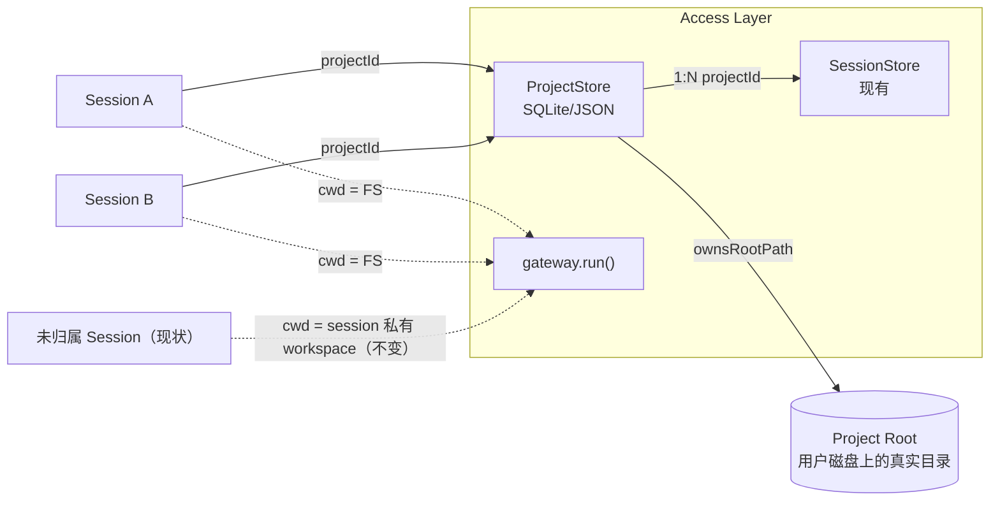

# 项目制（Project Workspace）技术方案

> 定位：在现有扁平的 Session 列表之上，新增一个持久化的「项目（Project）」实体，把多个对话绑定到同一个工作目录、同一份项目级记忆/MCP/Skill 默认配置上，而不是让每个对话各自拥有一次性、互相隔离的 workspace。

## 1. 现状调研结论

### 1.1 代码里已经有的「项目」概念，但只是“按目录扫描”，不是实体

仓库里确实多处出现 `PROJECT`，但都只是**某个目录是否存在某种配置文件**的静态扫描结果，没有对应的持久化领域对象：

- `backend/memory/models.py` 的 `MemoryType.PROJECT`：`discovery.py` 从 `instruction_root` 开始向上找 `CLAUDE.md` / `.claude/rules/*.md`，找到就标记成 `PROJECT` 级 memory。

```14:14:/Users/kanema/Desktop/k_agent/backend/memory/models.py
    PROJECT = "project"
```

- `access_layer/mcp_config.py` / `backend/mcp_tool/config.py` 的 `McpScope.PROJECT`：如果 cwd 下有 `.mcp.json` 就按 `PROJECT` 优先级加载。

```117:117:/Users/kanema/Desktop/k_agent/backend/mcp_tool/config.py
    sources.append((cwd / ".mcp.json", McpScope.PROJECT))
```

- `docs/features/agent-team-technical-solution.md` 里明确写了这是未来要做、现在没做的事：

```162:162:/Users/kanema/Desktop/k_agent/docs/features/agent-team-technical-solution.md
当前非编码任务模式不会创建或复制 Git 仓库；未来编码模式需要显式选择目标项目后再按需启用 worktree。
```

也就是说：**“项目级指令/项目级 MCP”这套发现逻辑已经写好了，但从来没有一个叫“项目”的持久化实体去驱动它**——它依赖的 `instruction_root` / `cwd`，目前永远等于一次性的会话 workspace，而不是用户长期维护的某个代码库或资料目录。

### 1.2 当前真实的数据模型：Session 是唯一的一等公民，且天然隔离

`access_layer/home.py` 定义的持久化布局里，没有 project 这一层：

```16:21:/Users/kanema/Desktop/k_agent/access_layer/home.py
  state/
    sessions/{id}/           # 会话 JSON + workspace/
    teams/                   # Team 控制面与任务目录
  content/
    memory/ / skills/
```

每个会话在创建时各自拿到一个独立、随会话生命周期走的 workspace：

```190:194:/Users/kanema/Desktop/k_agent/access_layer/home.py
def session_workspace_dir(session_id: str) -> Path:
    """对话绑定的 CLI/本地工具 cwd（非 Team 任务目录）。"""

    return session_bundle_dir(session_id) / "workspace"
```

运行时直接把这个目录当成 `instruction_root` / `cwd` 喂给 Runner（`access_layer/gateway.py`），sandbox 的可写根也来自同一个目录（`backend/sandbox/plan.py: allow_write = [str(workspace_root), ...]`）。

结果是：

- 两个“同一个项目”的对话，workspace 是两个毫不相干的空目录，彼此看不到对方写过的文件。
- `.mcp.json` / `CLAUDE.md` 这种“项目级”配置，用户必须在**每个会话的 workspace 里重复放一份**才会被发现——但会话 workspace 本来就是一次性、用完即弃的，没人会这么做，所以 `MemoryType.PROJECT` / `McpScope.PROJECT` 在实际产品里几乎从未被触发。
- `Team` 也是一样：`workspaceDir` 是 Team 级的，但 Team 和 Session 之间、Team 和 Team 之间都没有更上层的“项目”把它们串起来；`agent-team-technical-solution.md` 自己也承认“未来编码模式需要显式选择目标项目”还没做。
- 前端（`frontend/src/App.tsx`）的会话列表是纯扁平列表（`sessions: SessionSummary[]`），没有任何分组字段。

### 1.3 结论

“项目制”目前只存在于：① 代码里零散的 `PROJECT` 级配置发现逻辑，② 架构文档里一句面向未来的承诺。**没有 Project 持久化实体、没有 Project API、没有 Project 工作目录、没有会话到项目的归属关系、前端没有项目维度的 UI。** 本方案要补的就是这一层。

## 2. 术语澄清：Project 和 Session / Team 的关系

- **Session（对话）**：一次连续的人机对话流（现有概念，不变）。
- **Team（任务制）**：一次有明确目标、由多个 Agent 协作完成、可暂停可恢复的*任务*（见 `agent-team-technical-solution.md`，当前仍是设计稿）。
- **Project（项目制，本方案新增）**：一个长期存在的*工作空间容器*，拥有：
  - 一个稳定的根目录（可以是全新建的工作目录，也可以是用户磁盘上已有的代码仓库）；
  - 挂在这个根目录下的项目级记忆（`CLAUDE.md`）、项目级 MCP（`.mcp.json`）、项目默认 Skill/MCP 勾选；
  - 多个归属于它的 Session 和（未来）Team，这些 Session/Team 共享同一个根目录，而不是各自的一次性 workspace。

三者是正交的：Project 解决“工作目录与配置复用”，Session 解决“一段对话”，Team 解决“多 Agent 协作执行一次任务”。Team 的 `workspaceDir` 以后可以选择性地绑定到某个 Project 根目录（对应 1.1 节提到的那句 TODO），但 Team 领域模型本身不需要改。

## 3. 总体设计



核心原则：

1. **Project 是可选的一层，不是强制迁移。** 不归属任何 Project 的会话继续使用今天的私有一次性 workspace，完全不受影响——这是兼容性的硬约束。
2. **Project 不新建一套运行时。** 它只是在创建会话 / 发起 Run 时，把「这次 Run 的 cwd / instruction_root」从“会话私有目录”换成“所属 Project 的根目录”。Runner、Memory 发现、MCP 发现、Sandbox 全部复用现有逻辑，因为它们本来就是按目录扫描设计的（见 1.1）。
3. **Project 根目录归 Access Layer 持久化记录所有权，不归 Agent Backend。** Backend 继续无状态，只认一次 Run 传入的 `workspaceDir`。

## 4. 数据模型

新增 `ProjectRecord`（放在 `access_layer/projects/models.py`，命名和分层对齐现有 `access_layer/teams/models.py`）：

```python
class ProjectCreateInput(BaseModel):
    model_config = ConfigDict(populate_by_name=True)

    name: str = Field(min_length=1, max_length=120)
    description: str = Field(default="", max_length=4000)
    # 为空则在 $K_AGENT_HOME/state/projects/{id}/root 下新建空目录；
    # 非空则必须是用户磁盘上已存在、且通过路径白名单校验的绝对路径（已有代码仓库场景）。
    root_path: str | None = Field(default=None, alias="rootPath", max_length=4096)
    default_mcp_server_ids: list[str] = Field(default_factory=list, alias="defaultMcpServerIds")
    default_skill_ids: list[str] = Field(default_factory=list, alias="defaultSkillIds")
    permission_mode: PermissionMode = Field(default="default", alias="permissionMode")


class ProjectRecord(BaseModel):
    model_config = ConfigDict(populate_by_name=True)

    id: str
    name: str
    description: str = ""
    root_path: str = Field(alias="rootPath")          # 绝对路径，入库前已 resolve
    managed_root: bool = Field(alias="managedRoot")     # True=目录由本系统创建并拥有生命周期；False=指向用户已有目录，删除 Project 时不删文件
    default_mcp_server_ids: list[str] = Field(default_factory=list, alias="defaultMcpServerIds")
    default_skill_ids: list[str] = Field(default_factory=list, alias="defaultSkillIds")
    permission_mode: PermissionMode = Field(default="default", alias="permissionMode")
    session_count: int = Field(default=0, alias="sessionCount")
    created_at: datetime = Field(alias="createdAt")
    updated_at: datetime = Field(alias="updatedAt")
    revision: int = 0
```

`SessionSummary` / `SessionRecord` 增加一个可选字段：

```python
class SessionSummary(BaseModel):
    ...
    project_id: str | None = Field(default=None, alias="projectId")
```

现有会话该字段默认为 `None`，语义上等价于“未归属项目”，行为与今天完全一致。

## 5. 存储布局

延续 `access_layer/home.py` 的分层约定，新增：

```text
$K_AGENT_HOME/
  state/
    projects/
      index.json              # { "projects": [ProjectRecord, ...], "revision": N }  —— CAS 写，复用 StorageBackend.compare_and_swap_json
      {projectId}/
        root/                 # managed_root=True 时，真正的项目根目录（CLAUDE.md、.mcp.json、用户文件都在这里）
        meta.json              # 该 Project 自己的扩展元数据（可选，首版可以先并入 index.json）
    sessions/
      {sessionId}/{sessionId}.json   # 不变；新增 projectId 字段
```

- `managed_root=True`：根目录在 `$K_AGENT_HOME` 内部，由本系统创建、迁移、删除时一并清理，安全上等同于今天的会话 workspace，只是生命周期更长、被多个会话共享。
- `managed_root=False`：根目录指向用户磁盘上已有的目录（例如一个现有 git 仓库）。创建时必须：
  1. 要求绝对路径；
  2. 拒绝 `$K_AGENT_HOME` 自身、用户 home 根目录等过宽路径；
  3. 复用 `backend/sandbox/plan.py` 里已有的敏感路径黑名单思路（`~/.ssh`、`~/.aws`、目标目录下的 `.env` 继续拒绝读取）；
  4. 删除 Project 时只删 `index.json` 里的记录，绝不删除用户目录本身。

## 6. 与现有能力的衔接

这是本方案的核心价值：**不新造轮子，只是把已经存在的“按目录发现”的能力接上一个真实、持久、用户可见的目录。**

| 现有能力 | 现状触发条件 | 接入后 |
|---|---|---|
| `MemoryType.PROJECT`（`backend/memory/discovery.py`） | `instruction_root` 下某处有 `CLAUDE.md` | `instruction_root` = Project 根目录，用户在项目里长期维护的 `CLAUDE.md` 终于能被稳定发现 |
| `McpScope.PROJECT`（`access_layer/mcp_config.py`） | cwd 下有 `.mcp.json` | cwd = Project 根目录，项目自带的 `.mcp.json` 对该项目下所有会话生效 |
| Skill/MCP 勾选（`access_layer/catalog.py`） | 每个会话各自勾选 | 新会话归属某 Project 时，默认带入该 Project 的 `default_mcp_server_ids` / `default_skill_ids`，用户仍可在单次会话里覆盖 |
| Sandbox 可写根（`backend/sandbox/plan.py`） | `allow_write = [workspace_root, tmp]` | `workspace_root` = Project 根目录；多会话共享同一可写根，見 7.1 并发小节 |
| Team `workspaceDir`（`agent-team-technical-solution.md` 4.1 节） | 用户手填绝对路径，或默认落在 Team 自己的隔离目录 | 创建 Team 时可选择绑定到某个已存在的 Project，`workspaceDir` 直接取 Project 根目录，对应文档里“未来编码模式需要显式选择目标项目”这句话 |

## 7. 关键设计问题

### 7.1 并发：多个会话共享同一个 Project 根目录

这是引入 Project 之后**唯一真正的新风险**：今天一个会话独占一个 workspace，不存在并发写冲突；接入 Project 后，同一个 Project 下的多个会话可能并发跑 Run，都在往同一个目录写文件。

对策（分层防御，不引入新的分布式锁基础设施）：

1. **复用 `access_layer/concurrency.py` 的同会话锁**，并新增一个“同 Project 写锁”：同一 Project 下同一时刻只允许一个会话处于“正在执行工具 / 正在写文件”的 Run 阶段，其余并发请求排队，而不是报错。这是最小改动，优先级最高。
2. 第二阶段再考虑更细粒度的方案（例如参考 `agent-team-technical-solution.md` 里 Team 的 worktree 思路，让每个会话在 Project 根目录下拿到一个 git worktree 分支），但**不在首版范围**，首版用“Project 级串行锁”换取简单和正确性。
3. 前端在 Project 视图里需要明确提示：“该项目下有会话正在运行，新请求将排队”，避免用户以为卡住了。

### 7.2 安全边界：Project 根目录可以指向用户磁盘任意目录

- 复用现成的敏感路径黑名单逻辑（`.env`、`.ssh`、`.aws` 等），但黑名单要按 Project 根目录重新计算一次，而不是硬编码在会话 workspace 那一层。
- 创建/编辑 Project 时在 Access Layer 做路径白名单校验（拒绝根目录、用户 home 目录本身、`$K_AGENT_HOME` 自身），避免用户把 sandbox 可写根指向危险范围。
- `access_layer/workspace_fs.py` 现有的“过滤注入配置、禁止路径穿越”规则原样套用到 Project 根目录的只读预览接口上。

### 7.3 迁移与兼容

- 不做任何存量数据迁移：所有已存在的会话 `projectId` 为空，行为不变。
- 只在用户主动“新建项目”或“把会话归入项目”时才产生新行为，属于纯增量 opt-in 功能，回滚只需隐藏入口、不读取 `projectId` 字段。

## 8. API 设计

```text
GET    /api/projects                        # 列表（轻量摘要：id/name/sessionCount/updatedAt）
POST   /api/projects                        # 创建；body=ProjectCreateInput
GET    /api/projects/{projectId}            # 详情
PATCH  /api/projects/{projectId}            # 改名、改默认 MCP/Skill、改权限模式（不允许改 rootPath）
DELETE /api/projects/{projectId}            # managed_root=True 时级联清理 root/；=False 时只删记录
GET    /api/projects/{projectId}/sessions   # 该项目下的会话摘要列表
POST   /api/projects/{projectId}/sessions   # 在该项目下新建会话（等价于现有 /api/agent 创建会话时多传一个 projectId）
POST   /api/sessions/{sessionId}/project    # 把一个已存在、尚未归属项目的会话迁入某个 Project（workspace 内容原样拷贝过去，参考现有 fork_session 里 `_copy_workspace_tree` 的做法）
GET    /api/projects/{projectId}/workspace        # 只读预览 Project 根目录，复用 access_layer/workspace_fs.py
GET    /api/projects/{projectId}/workspace/file   # 同上
```

写操作沿用现有模式：`index.json` 用 `StorageBackend.compare_and_swap_json` 做乐观并发控制（`revision` 字段），与 `SessionStore` / Team Store 的持久化风格保持一致。

## 9. 前端改造

- `frontend/src/App.tsx` 的会话侧边栏从纯扁平列表，改为“项目分组 + 未分组会话”两段式展示；`projectId` 为空的会话继续显示在列表最前/最后一个隐式分组里，不强迫用户使用项目功能。
- 新增“新建项目”入口：选择「新建空目录」还是「打开已有目录」（后者走系统目录选择，前提是桌面/CLI 环境允许访问任意路径，纯 Web 部署场景下这一选项可以先关闭）。
- Project 详情页复用现有会话 workspace 预览组件（已经是通用组件，直接换数据源）。
- 新建会话时，如果当前处于某个 Project 视图下，默认带入该 Project 的 `projectId` 和默认 MCP/Skill 勾选。

## 10. 实施路线

### 10.1 阶段一：Project 实体与只读绑定（最小可用）

- `access_layer/projects/`：`models.py` + `store.py`（JSON + CAS，先不上 SQLite）。
- `ProjectRecord`、Project CRUD API。
- `SessionRecord` / `SessionSummary` 增加 `projectId`，创建会话时可选传入。
- `gateway.run()`：会话归属 Project 时，`instruction_root` / `cwd` 从 `session_workspace_dir` 换成 Project 根目录；未归属时行为不变。
- 验收：在同一个 Project 下建两个会话，第一个会话里写的文件，第二个会话能在 `ls` 工具里看到；Project 根目录下放一份 `CLAUDE.md`，两个会话都能加载到 `MemoryType.PROJECT`。

### 10.2 阶段二：并发写锁与 Sandbox 边界

- `access_layer/concurrency.py` 新增 Project 级串行锁。
- Sandbox 黑名单按 Project 根目录重新计算。
- 路径白名单校验（创建/编辑 Project 时拒绝危险根路径）。
- 验收：同一 Project 下两个会话同时触发 Run，后到的请求排队而不是产生文件竞态或 500。

### 10.3 阶段三：前端分组 UI + 已有会话迁移到项目

- 侧边栏分组、Project 详情页、"打开已有目录"入口。
- `POST /api/sessions/{id}/project`：把已有会话的 workspace 内容迁移进 Project 根目录。
- 验收：用户可以把今天已经在用的几个相关会话手动归并到新建的一个 Project 下，原有历史消息不受影响。

### 10.4 阶段四（可选，依赖 Team 方案推进）：Team 绑定 Project

- `TeamCreateInput.workspace_dir` 增加按 `projectId` 解析的分支，对应 `agent-team-technical-solution.md` 里“未来编码模式需要显式选择目标项目”。
- 不在本方案首个阶段强制实现，等 Team Runtime 基础（该文档 18.1 节）落地后再接入。

## 11. 测试要点

- Project CRUD 的并发写（两个请求同时 PATCH 同一个 Project）使用 `revision` CAS 正确拒绝旧版本。
- `managed_root=True` 删除 Project 时根目录被清理；`managed_root=False` 删除 Project 时用户目录完整保留。
- 路径校验：拒绝把 Project 根目录指向 `$K_AGENT_HOME`、用户 home 根目录、`/`、相对路径。
- 未归属 Project 的会话行为与改造前完全一致（回归测试）。
- 同一 Project 下并发两个 Run，断言不会产生交叉写入的部分文件（锁生效）。
- `MemoryType.PROJECT` / `McpScope.PROJECT` 在接入 Project 根目录后能被正确发现（现有 `test_prompt_memory.py` / memory discovery 测试的扩展用例）。

## 12. 明确的非目标（首版）

- 不做 Project 内多会话自动合并/冲突解决（那是 `agent-team-technical-solution.md` 里 Workspace/Worktree/Merge 的范畴，Project 只负责“共享一个目录”，不负责 Git 语义上的合并）。
- 不做跨 Project 的权限/多用户协作（当前整个系统仍是单用户本地优先模型）。
- 不在首版引入 SQLite；Project 数量级远小于 Session，JSON + CAS 足够，等后续确有需要再按 Team Store 的路线迁移。
- 不自动把存量会话迁移进任何 Project。

## 13. 现有代码参考位置

- `access_layer/home.py`：持久化目录布局，新增 `projects_dir()` 的落点。
- `access_layer/sessions/store.py` / `access_layer/sessions/workspace.py`：Session 持久化与 workspace 预览的既有实现，Project Store/workspace 预览直接复用同一套模式。
- `backend/memory/discovery.py`、`backend/memory/models.py`：`MemoryType.PROJECT` 的发现逻辑，本方案不改这里的代码，只改它的输入（`instruction_root`）。
- `access_layer/mcp_config.py`、`backend/mcp_tool/config.py`：`McpScope.PROJECT` 的发现逻辑，同上。
- `backend/sandbox/plan.py`：sandbox 可写根 `allow_write` 的来源，Project 接入后需要同步替换。
- `access_layer/teams/models.py`、`docs/features/agent-team-technical-solution.md`：`workspaceDir` 设计与“未来编码模式需要显式选择目标项目”的既有承诺，是阶段四的对接点。
- `access_layer/catalog.py`：MCP/Skill 选择解析，Project 默认勾选在这里被读取、合并进会话勾选。
